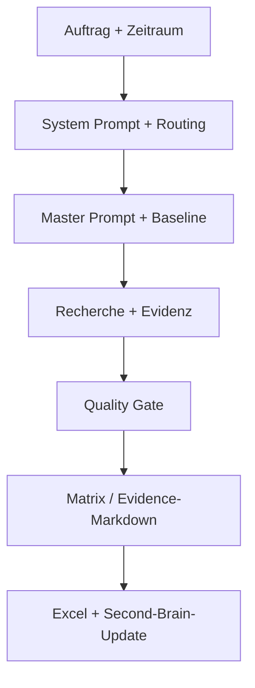

# PM Research Partner – Second Brain

**Stand:** 31.08.2026  
**Status:** gültig  
**Evidenzstatus:** mehrfach bestätigt  
**Zweck:** zentraler Einstiegspunkt und aktuelle Wahrheit für alle Durchläufe des PM Research Partners, PM Research Partners 2.0, der Hybridvariante und der entstehenden 2.1-DE/EN-Fassung

## 1. Aktueller Stand in 60 Sekunden

- **PM Research Partner 2.0** ist die gültige Bezeichnung der Vollversion. Die Architektur ist funktionsfähig; mehrere Release- und Governance-Themen sind noch offen.
- **PM Research Partner hybrid** ist die kompakte Arbeitsteilung: ChatGPT recherchiert und bewertet, Copilot v1.1 überträgt freigegebenes Evidence-Markdown technisch nach Excel. Die End-to-End-Abnahme fehlt.
- **PM Research Partner 2.1 – DE/EN** ist in Arbeit. Ein gemeinsamer bilingualer GPT ist beschlossen; ein separater EN-GPT ist nicht vorgesehen.
- **Ethernet-APL** besitzt eine gültige Baseline vom 29.06.2026. Das Routing verweist noch auf den ursprünglichen Master Prompt; die jüngere quellenoptimierte Fassung ist noch nicht als Produktionsfassung freigegeben.
- **Diagnose & Verifikation** besitzt eine provisorische Baseline vom 06.07.2026. Der aktuelle Master Prompt ist verfügbar, verlangt aber eine jüngere 6+1-Sheet-Struktur und strengere offizielle Nachweise.
- **Quality Gate** ist vierstufig definiert, aber Rolleninhaber und verbindlicher Freigabenachweis sind noch festzulegen.
- **Business Case:** Nutzen ist plausibel; 44 Stunden/Jahr sind eine historische Annahme, kein abgeschlossener Messwert. FILE-020 enthält zusätzlich einen frühen Kostenvergleich, dessen Zeitangaben widersprüchlich sind. Frühere Break-even-Zahlen sind nicht freigegeben.

## 2. Navigation

| Dokument | Inhalt | Wann lesen? |
|---|---|---|
| [README_PFLEGEANLEITUNG.md](README_PFLEGEANLEITUNG.md) | Pflegeprozess, IDs, Abschlusscheck | vor jeder Ergänzung |
| [01_PROJEKT_UND_ZIELBILD.md](01_PROJEKT_UND_ZIELBILD.md) | Zweck, Scope, Zielgruppen, Qualitätsversprechen | zum Einstieg |
| [02_ARCHITEKTUR_UND_VERSIONEN.md](02_ARCHITEKTUR_UND_VERSIONEN.md) | Systemarchitektur, VER-Register, Konflikte | bei Release-/Architekturfragen |
| [03_ENTSCHEIDUNGSREGISTER.md](03_ENTSCHEIDUNGSREGISTER.md) | alle beschlossenen und in Arbeit befindlichen Entscheidungen | vor Regeländerungen |
| [04_TESTREGISTER.md](04_TESTREGISTER.md) | Testchronik und Ergebnisse | vor Regression und Freigabe |
| [05_FEHLER_UND_LESSONS_LEARNED.md](05_FEHLER_UND_LESSONS_LEARNED.md) | Fehlerursachen, Korrekturen, generalisierte Regeln | vor Prompt-/Workflowänderungen |
| [06_RECHERCHEHISTORIE.md](06_RECHERCHEHISTORIE.md) | dokumentierte Research-Durchläufe und Baselines | vor neuen Updates |
| [07_PROMPT_UND_DATEIENREGISTER.md](07_PROMPT_UND_DATEIENREGISTER.md) | Rollen und Status operativer Dateien | vor Dateiauswahl |
| [08_BUSINESS_CASE_UND_VALUE.md](08_BUSINESS_CASE_UND_VALUE.md) | Nutzen, Messmodell, Kosten-/Lizenzlogik | für Stakeholder- und Investitionsfragen |
| [09_OFFENE_PUNKTE_UND_ROADMAP.md](09_OFFENE_PUNKTE_UND_ROADMAP.md) | OPEN-Register, Prioritäten und Releasefolge | für nächste Arbeitsschritte |
| [10_GLOSSAR_UND_REGELWERK.md](10_GLOSSAR_UND_REGELWERK.md) | verbindliche Fachbegriffe und Schutzregeln | bei Fach- und Statusfragen |
| [ARCHIV](ARCHIV/) | einzelne Test-, Recherche- und Quellennachweise | für Detailprüfung |
| [VORLAGEN](VORLAGEN/) | Vorlagen für RUN, TEST und DEC | bei neuen Einträgen |
| [VALIDIERUNGSBERICHT_2026-08-31.md](VALIDIERUNGSBERICHT_2026-08-31.md) | Umfang und Ergebnis der Initialprüfung | für Abnahme und Übergabe |

## 3. Systembild

Das Second Brain steuert und dokumentiert die Methode. Es ersetzt die operativen Prompts, Matrizen und Ergebnisdateien nicht.

## 4. Aktive Produktversionen

| Version | Bezeichnung | Status | Aktuelle Bedeutung | Nächster Nachweis |
|---|---|---|---|---|
| VER-001 | Ursprungsversion | archiviert | fachlicher Ursprung | keiner; historische Referenz |
| VER-002 | PM Research Partner 2.0 | gültig | Vollversion | Release-Dateien und QG-Governance härten |
| VER-003 | PM Research Partner hybrid | in Arbeit | ChatGPT-Research + Copilot-Excel | Copilot-v1.1-E2E-Test |
| VER-004 | PM Research Partner 2.1 – DE/EN | in Arbeit | ein gemeinsamer bilingualer GPT | vollständige DE/EN-Regression |
| VER-005 | kompakter Entwicklungsstrang | zu prüfen | Herkunft mehrerer Hybridideen | Rolle gegenüber VER-003 klären |

Verbindliche Benennung: `2.0` bedeutet Vollversion; `hybrid` bedeutet die kompakte Copilot-Variante.

## 5. Aktive Fachrouten und Baselines

| Fachroute | Produktiv referenzierter Master | jüngerer Kandidat/Stand | Baseline | Zustand |
|---|---|---|---|---|
| Ethernet-APL / PoE / PoDL | FILE-004 | FILE-005 quellenoptimiert | FILE-007, Stand 29.06.2026 | grundsätzlich funktionsfähig; Master-Release offen |
| Diagnose & Verifikation | FILE-006, Stand 27.08.2026 | kein jüngerer bereitgestellter Stand | FILE-008, Stand 06.07.2026 | Baseline-Nachbelegung und 6+1-Sheet-Migration offen |

Vor jedem Lauf sind Route, Master Prompt, Baseline, letzter Abruf und aktueller Abruf zu bestätigen.

## 6. Verbindliche Fach- und Qualitätsregeln

### Ethernet-APL

- `verfügbar` nur mit ausdrücklichem Ethernet-APL-Nachweis zur konkreten Produkt-/Variantenkombination.
- PoE, PoDL oder allgemeines Industrial Ethernet sind kein Ethernet-APL-Nachweis.
- `nicht vorhanden` nur mit ausdrücklichem Negativnachweis; sonst `keine Infos`.
- Ein belegtes Kommunikationsprofil darf nur bei gleichzeitig belegtem APL in einer positiven APL-Zelle erscheinen.
- Produktnachbarschaft auf einer Seite oder in einem Dokument ist keine Belegübertragung.

### Verifikation

- Verifikation ist eine aktiv initiierte oder geführte Prüfung gegen Referenzbedingungen mit dokumentiertem Ergebnis.
- Diagnose, NE107, Condition Monitoring, Predictive Maintenance und Kalibrierung sind kein Ersatznachweis.
- KROHNE OPTICHECK ist Benchmark, aber nicht vorab positiv gesetzt.
- Kandidaten bleiben vor dem Quality Gate sichtbar; finale Matrix, Delta und Summary nutzen ausschließlich Nachher-Ergebnisse.

### Delta und Evidenz

- Zulässige Deltaarten: `Neu`, `Geändert`, `Entfernt / abgekündigt`, `Unklar`.
- `Unverändert` wird nicht ausgegeben.
- Neu gefunden, neu im Scope oder Korrektur der Baseline ist nicht automatisch `Neu`.
- Materielle Aussagen benötigen atomare Direktquellen; unter 95 % keine bestätigte Positivaussage.
- Sicherheitslevel ersetzen keine fachliche Prüfung.

## 7. Aktuelle operative Kerndateien

| ID | Datei/Rolle | Status | Hinweis |
|---|---|---|---|
| FILE-001 | deutscher System Prompt | zu prüfen | lange Fassung; Produktivrolle gegenüber kompaktem Kandidaten offen |
| FILE-002 | englischer System Prompt | in Arbeit | Übersetzung vorhanden, Regression fehlt |
| FILE-003 | Routing Index | gültig | APL-Verweis noch auf FILE-004 |
| FILE-004 | ursprünglicher APL-Master | gültig | derzeit im Routing referenziert |
| FILE-005 | quellenoptimierter APL-Master | zu prüfen | jüngere Fassung, Release offen |
| FILE-006 | aktueller Verifikations-Master | gültig | Baseline-Migration fehlt |
| FILE-007 | APL-Baseline 01 | gültig | fachlicher Stand 29.06.2026 |
| FILE-008 | Verifikationsbaseline 02 | gültig/teilweise zu prüfen | fachlicher Stand 06.07.2026 |
| FILE-009 | Sprachplan | in Arbeit | noch nicht vollständig umgesetzt |
| FILE-015 | Copilot v1.1 | in Arbeit | E2E-Abnahme fehlt |

Exakte Metadaten und historische Dateien: [07_PROMPT_UND_DATEIENREGISTER.md](07_PROMPT_UND_DATEIENREGISTER.md).

## 8. Dokumentierte Research-Baselines und letzter Laufstand

| Bereich | letzte belastbare Referenz | Einordnung |
|---|---|---|
| Ethernet-APL | RUN-007, korrigierter Lauf vom 06.08.2026 | freigegeben mit offenem Baseline-Datumshinweis |
| Ethernet-APL Testserie | RUN-008, 10.–13.08.2026 | keine gemeinsame Produktionsfreigabe; Quellenkonsistenzproblem führte zu FILE-005 |
| Verifikation | FILE-008, Stand 06.07.2026 | provisorische Baseline mit offiziellem Nachbelegungsbedarf |
| Verifikationsupdate | RUN-009, Auftrag vom 27.08.2026 | Ergebnisdatei nicht im Korpus; Status zu prüfen |

Die Research-Historie umfasst RUN-001 bis RUN-009. Neue Läufe beginnen mit RUN-010.

## 9. Wichtigste bestätigte Entscheidungen

- DEC-001: modulare Architektur statt Mega-Prompt.
- DEC-002: Routing vor jeder Recherche.
- DEC-003 und DEC-004: Update bei Baseline; Zeitraum und Baseline als Preflight-Pflicht.
- DEC-005 bis DEC-010: Technologie-, Status-, Delta-, Quellen- und Sicherheitslogik.
- DEC-011 bis DEC-014: strikte Verifikationsdefinition und dokumentiertes Quality Gate.
- DEC-015: verbindliche Produktbegriffe 2.0 und hybrid.
- DEC-016 und DEC-017: Hybrid-Arbeitsteilung und Copilot v1.1.
- DEC-018 und DEC-019: ein gemeinsamer bilingualer GPT; Sprache nur in der Präsentationsschicht.
- DEC-021: direkte Quellenoptimierung als eigener Entwicklungsstrang.
- DEC-023: dieses modulare Second Brain ist die projektübergreifende Wissensbasis.

Vollständige Begründungen: [03_ENTSCHEIDUNGSREGISTER.md](03_ENTSCHEIDUNGSREGISTER.md).

## 10. Kritische bekannte Fehlerbilder

| Fehlerbild | Referenz | Verbindliche Prävention |
|---|---|---|
| H250 M40 fälschlich APL-positiv durch benachbarten Produktblock | ERR-001 | atomare Produkt-/Variantenbelegkette |
| ABB Vortex nur indirekt belegt | ERR-002 | direkte Quelle oder `keine Infos` |
| inkonsistente Datums-/Delta-Logik | ERR-003, ERR-006, ERR-007 | Preflight und klare Intervallgrenzen |
| PoE-/PoDL-Sheet veraltet | ERR-004 | alle abhängigen Sheets und Summary propagieren |
| Quality Gate behauptet, aber nicht dokumentiert | ERR-005 | Einwände, Korrekturen und Freigabe protokollieren |
| Diagnose als Verifikation gewertet | ERR-008 bis ERR-010 | DEC-011 und offizielle Produkt-Tool-Kette |
| Copilot v1 blockiert verwertbare Daten | ERR-013 | v1.1: Hard Stop nur bei technischen Blockern |
| gewünschte EN-Ausgabe bleibt deutsch | ERR-014 | zentrale Sprachsteuerung und Regression |
| Quelle allgemein oder im falschen Produktkontext | ERR-016 bis ERR-018 | Atomisierung, Direktquelle, korrekte Sicherheitsbewertung |

Alle Korrekturen und 43 generalisierten Lessons Learned: [05_FEHLER_UND_LESSONS_LEARNED.md](05_FEHLER_UND_LESSONS_LEARNED.md).

## 11. P0-Risiken und nächste Schritte

| ID | Thema | Nächste Handlung | Exit-Kriterium |
|---|---|---|---|
| OPEN-013 | QG-Verantwortung | Rollenmatrix und Mindestprotokoll bestätigen | benannte Owner und versioniertes QG-Protokoll |
| OPEN-003 | APL-Produktionsmaster | FILE-004 und FILE-005 diffen und Release festlegen | genau eine produktive Fassung im Routing |
| OPEN-004 | Hybrid-E2E | RUN-007 mit Copilot v1.1 nach Excel übertragen | technisch korrekt, fachlich unverändert |
| OPEN-008 | Verifikationsschema | Baseline auf sechs Pflicht-Sheets migrieren | Datenvertrag und Regression bestanden |
| OPEN-010 | Verifikationsnachweise | positive Kandidaten offiziell nachbelegen | atomare Direktquelle und ≥95 % je positive Zelle |
| OPEN-009 | Lauf 27.08. | Ergebnis beschaffen oder reproduzieren | Ergebnis/Freigabe eindeutig dokumentiert |
| OPEN-005 | DE/EN 2.1 | Routing/Master/Mapping migrieren und testen | zweisprachige Regression bestanden |

Vollständige 17-Punkte-Roadmap: [09_OFFENE_PUNKTE_UND_ROADMAP.md](09_OFFENE_PUNKTE_UND_ROADMAP.md).

## 12. Business-Case-Status

- Werttreiber: weniger Wiederholungsarbeit, bessere Belegqualität, Wissenserhalt, schnellere Entscheidungen und Skalierbarkeit.
- Historische Zeitannahme: 44 Stunden/Jahr; noch in echten Zyklen zu messen.
- FILE-020: Make wurde historisch mit Nutzwert 4,25 und 420,72 € Jahreskosten bewertet; das Zeitmodell ist in TEST-014 als inkonsistent dokumentiert.
- Historische Break-even-Werte: archiviert und nicht freigegeben.
- Aktueller Hybrid: ChatGPT für Recherche/Reasoning, Copilot Chat Basic für Excel-Übertragung.
- Premium- oder finale Lizenzentscheidung: erst nach E2E- und Pilotmessung.

Messmodell und KPIs: [08_BUSINESS_CASE_UND_VALUE.md](08_BUSINESS_CASE_UND_VALUE.md).

## 13. Registerumfang und nächste IDs

| Register | vorhandener Bereich | nächste ID |
|---|---|---|
| Entscheidungen | DEC-001 bis DEC-023 | DEC-024 |
| Tests | TEST-001 bis TEST-014 | TEST-015 |
| Fehler | ERR-001 bis ERR-019 | ERR-020 |
| Lessons Learned | LESSON-001 bis LESSON-044 | LESSON-045 |
| Rechercheläufe | RUN-001 bis RUN-009 | RUN-010 |
| Offene Punkte | OPEN-001 bis OPEN-018 | OPEN-019 |
| operative Dateien | FILE-001 bis FILE-023 | FILE-024 |
| Produkt-/Architekturversionen | VER-001 bis VER-005 | VER-006 |

## 14. Ergänzungsworkflow

1. Passende Vorlage aus [VORLAGEN](VORLAGEN/) kopieren.
2. Nächste unverbrauchte ID vergeben.
3. Evidenz, Status, Datum, betroffene Versionen und Verknüpfungen eintragen.
4. Detailregister und gegebenenfalls Archiv ergänzen.
5. Bei neuer gültiger Wahrheit diesen Index aktualisieren.
6. IDs, Statuswerte, Links, Fachgrenzen, Delta und QG prüfen.

Alte Einträge werden nie still gelöscht oder umgeschrieben. Sie bleiben mit `ersetzt`, `verworfen` oder `archiviert` nachvollziehbar.

## 15. Gültigkeits- und Autoritätsregel

Bei Konflikten gilt:

1. neueste ausdrückliche Nutzerentscheidung,
2. aktuell ausdrücklich freigegebene operative Datei,
3. jüngere freigegebene Version derselben Datei,
4. datierte Baseline oder Ergebnisdatei,
5. dokumentierter Test,
6. historische Gesamtübergabe,
7. Gesprächshistorie,
8. unbestätigter Vorschlag.

Der Index fasst die aktuelle Wahrheit zusammen. Das Archiv erhält den historischen Nachweis.
