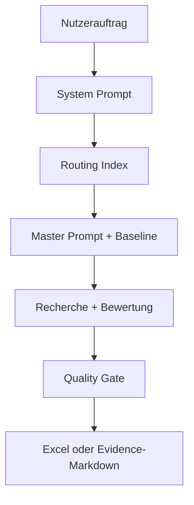

# Architektur und Versionen

**Stand:** 31.08.2026  
**Status:** gültig  
**Einordnung:** Architektur- und Versionsübersicht

## 1. Aktuelle modulare Architektur

### System Prompt

Enthält ausschließlich die übergeordnete Steuerung:

- Rolle und Anwendungsbereich,
- Pflicht zur Nutzung des Routing Index,
- Prioritätenhierarchie,
- Standardmodus und Pflichtangaben,
- globale Schutz- und Qualitätsregeln,
- Arbeitsstil.

### Routing Index

Ordnet den Auftrag einem Recherchebereich zu und wählt:

- passenden Master Prompt,
- passende Baseline,
- Fallback bei fehlender oder unklarer Zuordnung.

### Master Prompt

Enthält die vollständige themenspezifische Fachmethodik:

- Scope,
- Status- und Delta-Logik,
- Quellen- und Sicherheitsregeln,
- Rechercheablauf,
- Quality Gate,
- Ausgabe- und Excel-Vertrag.

### Baseline

Ist der dokumentierte alte Markt- und Bewertungsstand. Sie ist Vergleichsbasis, aber nicht automatisch fehlerfreie Wahrheit.

### Ergebnis und Quality Gate

Recherche, Quellenprüfung, Advisor-Perspektive und Final Approval führen zu einer freizugebenden Datei. Bei der Hybridvariante ist ein freigegebenes Evidence-Markdown die Schnittstelle zur Excel-Erzeugung.

## 2. Aktive Routen

| Route | Master Prompt | Baseline | Status |
|---|---|---|---|
| Ethernet-APL / PoE / PoDL | `Master-Prompt Ethernet-APL.md`; quellenoptimierter Nachfolgekandidat vorhanden | `Ausgangsmatrix 01.xlsx` | grundsätzlich funktionsfähig; finale Master-Prompt-Freigabe offen |
| Diagnose & Verifikation | `Master-Prompt Verifikation.md` | `Ausgangsmatrix_02.xlsx` | aktueller Master verfügbar; Baseline-Nachbelegung und End-to-End-Test offen |

## 3. Produkt- und Architekturversionen

### VER-001 – PM Research Partner Ursprungsversion

- Status: archiviert
- Zeitraum: Entwicklungsphase bis zur modularen 2.0-Architektur
- Evidenzstatus: historisch dokumentiert
- Zweck: erste Ethernet-APL-Marktanalysen und Entwicklung der Matrix-/Update-Logik
- Merkmale: stärker einzelfall- und promptorientiert; schrittweise Einführung von Baseline, Delta, Quellenregister und Quality Gate
- Ersetzt durch: VER-002

### VER-002 – PM Research Partner 2.0

- Status: gültig
- Einordnung: Vollversionsdefinition ist gültig; Release-Härtung bleibt in Arbeit.
- Evidenzstatus: mehrfach bestätigt
- Definition: Vollversion des PM Research Partners
- Recherche: ChatGPT führt Webrecherche, Quellenkritik und Fachbewertung aus
- Architektur: System Prompt → Routing Index → Master Prompt → Baseline
- Fachbereiche: Ethernet-APL sowie Diagnose & Verifikation
- Ausgabe: vollständige Matrix-/Excel-Ausgabe mit Quellen, Delta und optionaler Summary
- Qualität: Status, Delta, Sicherheitslevel und mehrstufiges Quality Gate
- Bekannte Stärken: modulare Regeln, Technologieabgrenzung, konservative Bewertung, Erweiterbarkeit
- Offene Release-Themen: produktive Dateiversionen, Moduskonsistenz, Quality-Gate-Dokumentation, Verifikationsbaseline, Sicherheitskriterien
- Verknüpfungen: DEC-001 bis DEC-011; TEST-001 bis TEST-009

### VER-003 – PM Research Partner hybrid

- Status: in Arbeit
- Evidenzstatus: mehrfach bestätigt
- Definition: kompakte ChatGPT/Copilot-Variante
- ChatGPT-Aufgabe: Recherche, Quellenbewertung, Fachstatus, Delta, Sicherheitslevel und freigegebenes Evidence-Markdown
- Copilot-Aufgabe: strukturgetreue Übertragung in eine Kopie der Excel-Ausgangsmatrix
- Copilot darf nicht: Webrecherche, fachliche Neubewertung, Ergänzung aus Modellwissen oder Umdeutung
- Aktueller Excel-Prompt: Copilot v1.1
- Vorgänger: Copilot v1, wegen zu strengem Preflight ersetzt
- Offener Nachweis: vollständiger reproduzierbarer End-to-End-Test auf Microsoft 365 Copilot Chat Basic
- Verknüpfungen: DEC-012, DEC-013; TEST-010, TEST-011; OPEN-004

### VER-004 – PM Research Partner 2.1 – DE/EN

- Status: in Arbeit
- Evidenzstatus: direkt belegt
- Definition: gemeinsame bilinguale Vollversion ohne doppelte Fachlogik
- Beschlossene Richtung: ein gemeinsamer GPT, kein dauerhaft separater EN-GPT
- Architektur: Sprache wird einmal pro Auftrag bestimmt; Fachbewertung bleibt sprachneutral; Präsentationsschicht wird gemappt
- Fortschritt: `PLAN_Sprache(1).md` und `System_Prompt_en(1).md` vorhanden
- Noch offen: zentraler produktiver Sprachblock, Mapping-Datei, Anpassung beider Master Prompts, vollständige DE/EN-Regression und Produktivfreigabe
- Verknüpfungen: DEC-014; TEST-012; OPEN-005

### VER-005 – Kompakte Free-/Kontextvariante

- Status: zu prüfen
- Einordnung: kein eigener freigegebener Produktname.
- Evidenzstatus: historisch dokumentiert
- Zweck: kleinere aktive Promptbudgets und Übergabe der Excel-Aufgabe an Copilot
- Artefakte: `System-Prompt_new.md`, kompakter `Master-Prompt Ethernet-APL(2).md`, kompaktere Verifikationsstände
- Ergebnis: zentrale Schutzregeln konnten erhalten werden, aber Überstrenge und Moduskonflikte traten auf
- Einordnung: Entwicklungsstrang, der in VER-003 eingeflossen ist; nicht automatisch produktive Alternative zu VER-002

## 4. Versionschronik

| Zeitraum | Entwicklung | Ergebnis |
|---|---|---|
| bis 10/2025 | ursprüngliche Ethernet-APL-/PoE-/PoDL-Marktstudie | fachlicher Ausgangspunkt |
| 06/2026 | System-/Routing-Architektur und Ethernet-APL-Master | modularer Research Partner entsteht |
| 29.06.2026 | erweiterte Ethernet-APL-Baseline mit acht Kategorien | Baseline 01 |
| 06.07.2026 | Verifikationsbaseline aus internen Decks | Baseline 02, noch nachzubelegen |
| 07/2026 | direkte Belegketten und Verifikationsabgrenzung | Fachlogik verschärft |
| 03.–06.08.2026 | Ex-post-Audit und korrigierter APL-Lauf | kritische Quellen-/Datumsfehler sichtbar und korrigiert |
| 07.–11.08.2026 | Copilot-Prompt v1 → v1.1 | Hybrid-Workflow präzisiert |
| 13.08.2026 | DE/EN-Entscheidung und Sprachplan | VER-004 begonnen |
| 27.08.2026 | aktueller Verifikations-Master und quellenoptimierter APL-Master bereitgestellt | wichtige frühere Blockade behoben; Produktivfreigabe noch offen |
| 31.08.2026 | englische System-Prompt-Fassung und Second Brain | Architekturübersetzung fortgeschritten; Wissensgovernance eingeführt |

## 5. Aktuelle Architekturkonflikte

### 5.1 Lange vs. kompakte System-Prompt-Fassung

- Lange deutsche Fassung: 6.728 Bytes; direkt bereitgestellt.
- Kompakter Kandidat: ca. 2.769 Bytes; historisch vorhanden.
- Englische Fassung: 5.607 Bytes; direkt bereitgestellt.
- Entscheidung, welche Fassung produktiv maßgeblich ist, ist nicht ausdrücklich dokumentiert.

### 5.2 Erst-Recherche vs. Update-only

- Ausführliche Master Prompts unterstützen Erst- und Update-Recherche.
- Kompakter System-Prompt-Kandidat war Update-only.
- Der aktuelle lange System Prompt nutzt Update als Standard, wenn eine Baseline vorhanden ist.
- Eine widerspruchsfreie Produktivregel ist noch festzulegen.

### 5.3 Ethernet-APL-Master: ursprüngliche vs. quellenoptimierte Fassung

- Der Routing Index nennt weiterhin `Master-Prompt Ethernet-APL.md`.
- Die jüngere Datei `Master-Prompt Ethernet-APL Quellen optimiert.md` enthält umfassendere Belegregeln.
- Ein ausdrücklicher Releaseentscheid oder aktualisierter Routing-Verweis fehlt.

### 5.4 Verifikations-Master vs. Baseline-Struktur

- Baseline 02 besitzt fünf Sheets.
- Der aktuelle Master vom 27.08.2026 verlangt sechs Pflicht-Sheets plus optionales siebtes Sheet und separate Vorher-/Nachher-Matrizen.
- Die technische Migration der Baseline und ein vollständiger Test sind noch offen.

### 5.5 Dateinamen

Leerzeichen, Unterstriche, Nummernzusätze und fehlende Endungen variieren zwischen Routing, Library und Dateien. Dies ist ein funktionales Risiko, kein kosmetisches Thema.

## 6. Autoritätsmodell

Bei Konflikten gilt für das Second Brain:

1. neueste ausdrückliche Nutzerentscheidung,
2. aktuell ausdrücklich freigegebene operative Datei,
3. jüngere freigegebene Version derselben Datei,
4. datierte Baseline oder Ergebnisdatei,
5. dokumentierter Test,
6. Gesamtübergabe,
7. Gesprächshistorie,
8. unbestätigte Assistentenvorschläge.

Fachliche Schutzregeln werden nicht durch beiläufige Scope- oder Formatwünsche aufgehoben.

## 7. Erweiterung um neue Recherchebereiche

Ein neuer Bereich wird erst aktiv, wenn mindestens vorhanden sind:

- eindeutige Trigger,
- Master Prompt,
- Baseline oder definierter Erst-Recherche-Modus,
- Status- und Delta-Logik,
- Quellen- und Sicherheitsregeln,
- Outputvertrag,
- Routingtest,
- Gold-Standard-Testfall,
- Freigabe und Dateiregistereintrag.
